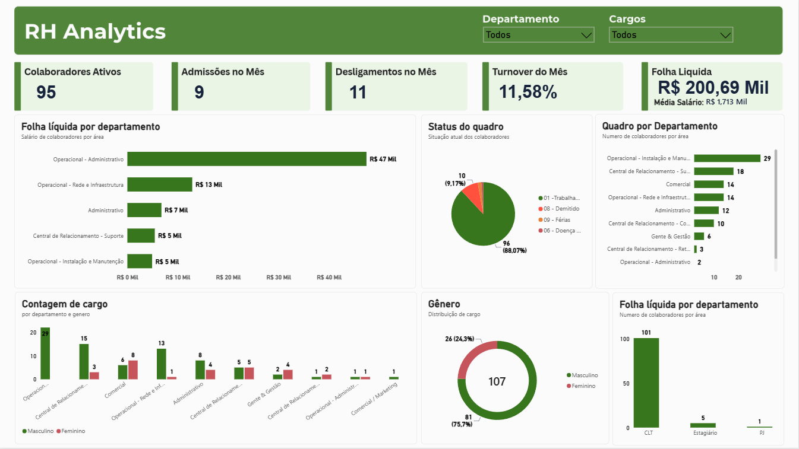

# HR Analytics Dashboard (Power BI)

Interactive Power BI dashboard to track hiring, terminations, turnover and absenteeism by department.

## Business problem
The HR team was dealing with high employee turnover (frequent hires and exits) and had no clear view of **which departments needed more staff**. This dashboard centralizes the data to support hiring decisions.

## Solution
A Power BI report built on an HR spreadsheet, with a data model, DAX measures and visuals focused on headcount movement and absenteeism.

## Key questions answered
- Which departments have the highest turnover?
- How do hires and terminations evolve over time?
- Where is absenteeism concentrated?
- [add 1–2 questions the dashboard really answers]

## Data model
Tables: `Admitidos` (hires), `Demitidos` (terminations), `Cargos` (positions), `Funcionario` (employees), `Folha de Pagamento` (payroll), `Absentismo` (absenteeism) and a `Medidas Principal` table holding the DAX measures.

[Insert a screenshot of the model view with the relationships]

## Main DAX measures
- **Turnover Rate:** [Taxa de Turnover = DIVIDE([Desligamentos no Mês], [Colaboradores Ativos], 0)]
- **Total de Funcionariso:** [total de funcionarios = DISTINCTCOUNT(Funcionario[nome_funcionario])]
- **Colaboradores Ativos:** [Colaboradores Ativos = CALCULATE(COUNTROWS(Funcionario), Funcionario[status_funcionario] = "01 -Trabalhando")]

## Dashboard preview

## Key insights
- [insight 1, e.g., which department had the highest turnover]

> Note: all data shown is anonymized / sample data.

## Tools
Power BI, DAX, Power Query, Excel

## Possible next steps
- Connect to a database instead of a spreadsheet
- Add a forecast of hiring needs by department
- [your ideas]

## Author
Maycon Castro · [www.linkedin.com/in/maycon-castro ] · [https://github.com/maycon-castro-git]
